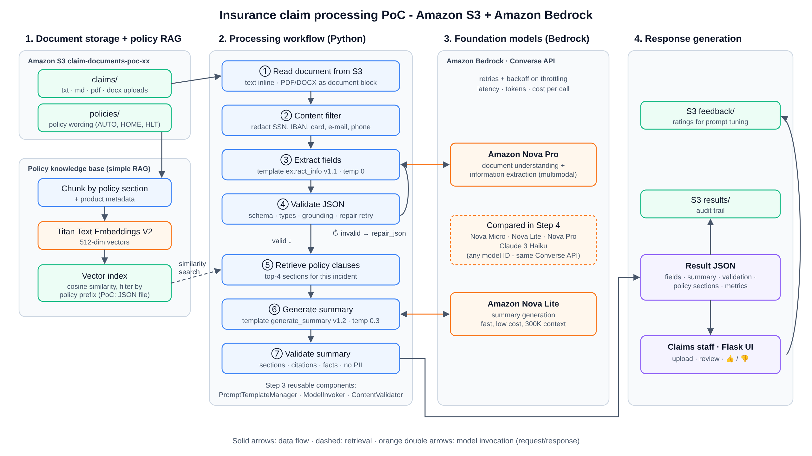

# Step 1 – Design the architecture (Skill 1.1.1)

*(Source: `architecture.svg`. Open it in a browser to zoom.)*

## 1.1 Components

| Assignment item | Implementation | File |
|---|---|---|
| **Document storage** | One S3 bucket with prefixes `claims/`, `policies/`, `results/`, `feedback/`. Public access is blocked and SSE-S3 encryption is on by default, because claims contain PII. | `step2_poc/setup_aws.sh`, `step2_poc/s3_storage.py` |
| **Processing workflow** | A Python pipeline: read → redact PII → extract → validate (repair retry) → retrieve policy clauses → summarise → validate | `step2_poc/claim_processor.py` (simple), `step3_components/claim_pipeline.py` (production-style) |
| **Foundation model integration** | Bedrock **Converse API**: one request format for every model, so switching models only means changing the model ID | `step3_components/model_invoker.py` |
| **Response generation** | Result JSON (fields, summary, validation, policy sections, metrics) saved to `results/` and shown in the Flask UI | `extras/web_app.py` |

## 1.2 Model selection

| Task | Chosen model | Why | Alternatives |
|---|---|---|---|
| **Document understanding** (PDF, scans, tables) | **Amazon Nova Pro** | Multimodal (reads PDF, DOCX and images via Converse document/image blocks), 300K-token context, strong reasoning, about 4× cheaper than comparable Claude Sonnet models | Claude Sonnet (highest accuracy on messy layouts); Amazon Textract + a text model for heavy OCR workloads |
| **Information extraction** (strict JSON) | **Amazon Nova Pro** at temperature 0 | Extraction errors flow into every downstream decision, so accuracy matters more than price here. Temperature 0 gives deterministic output. | Nova Lite if Step 4 shows equal accuracy on your documents |
| **Summary generation** | **Amazon Nova Lite** at temperature 0.3 | The facts are already extracted and the policy clauses are retrieved, so the model only writes grounded prose. A fast, cheap model is enough. | Claude 3 Haiku (good prose); Nova Micro (text-only, cheapest) |
| **Embeddings for RAG** | **Amazon Titan Text Embeddings V2** (512 dimensions) | Native to Bedrock, cheap, configurable dimensions, works well for short policy clauses | Cohere Embed (multilingual) |

**Design principle:** pick the model per task, not per application. The Converse API plus `config.py` makes each choice a one-line change, and Step 4 checks the choice with measurements.

## 1.3 Key design decisions

1. **Converse API instead of `invoke_model`.** The course snippet uses `anthropic.claude-v2` with the old `prompt`/`completion` format. That model is legacy, and the format is model-specific. Converse works across Nova, Claude, Llama and Mistral without changes.
2. **Cross-region inference profiles** (`us.` / `eu.` prefixes) for higher throughput and availability.
3. **RAG with a metadata filter.** Policy chunks are tagged with their product (AUTO, HOME, HLT). Retrieval first filters by the claim's policy-number prefix, so a home claim never gets auto-policy clauses.
4. **Guardrails in code.** PII is redacted *before* the model call, and the JSON and the summary are validated *after* it. Amazon Bedrock Guardrails is the managed alternative for production.
5. **Production path:** S3 event → Step Functions → Lambda for each stage; Bedrock Knowledge Bases instead of the local vector index; DynamoDB for results; Bedrock Guardrails; CloudWatch metrics for latency, tokens and validation failures.

➡ Next: [Step 2 – Implement the proof of concept](../step2_poc/README.md)
